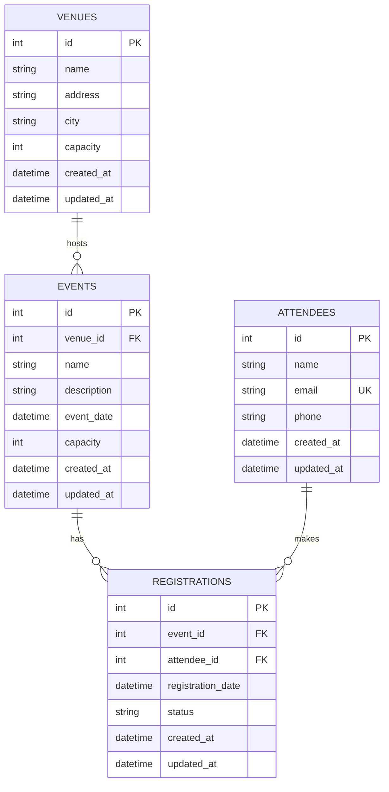

 Event Management System – ER Diagram

 1. Entity Relationship Diagram

The Event Management System consists of four entities: Venues, Events, Attendees, and Registrations.

2. Entity Descriptions

| Entity | Description |
|---|---|
| Venues | Stores information about event locations |
| Events | Stores event information and venue references |
| Attendees | Stores information about people attending events |
| Registrations | Connects attendees with events |

 3. Relationships

1. **Venues – Events:** One venue can host multiple events. Each event belongs to one venue.
2. **Events – Registrations:** One event can have multiple registrations.
3. **Attendees – Registrations:** One attendee can make multiple registrations.
4. **Events – Attendees:** Events and attendees have a many-to-many relationship through the Registrations entity.

 4. Constraints

- Each entity has a primary key.
- Events reference Venues using `venue_id`.
- Registrations reference Events using `event_id`.
- Registrations reference Attendees using `attendee_id`.
- Attendee email addresses must be unique.
- The combination of `event_id` and `attendee_id` must be unique in Registrations.

 5. Conclusion

The database design uses primary keys, foreign keys, and relational constraints to maintain data integrity and establish relationships between venues, events, attendees, and registrations.